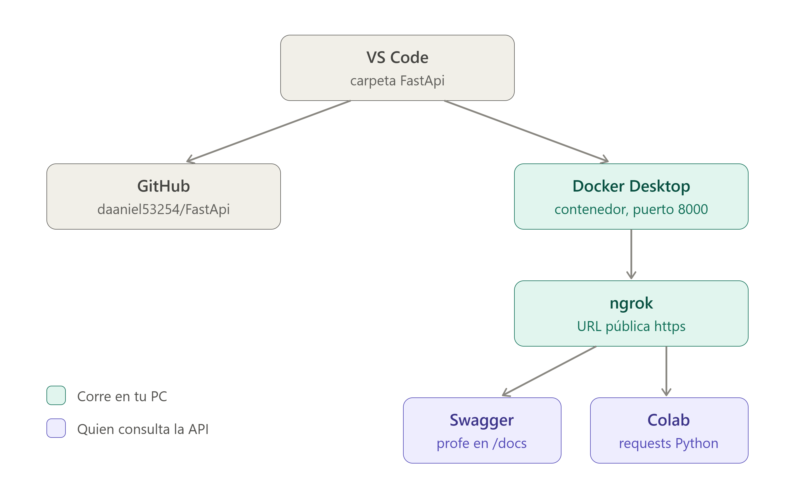
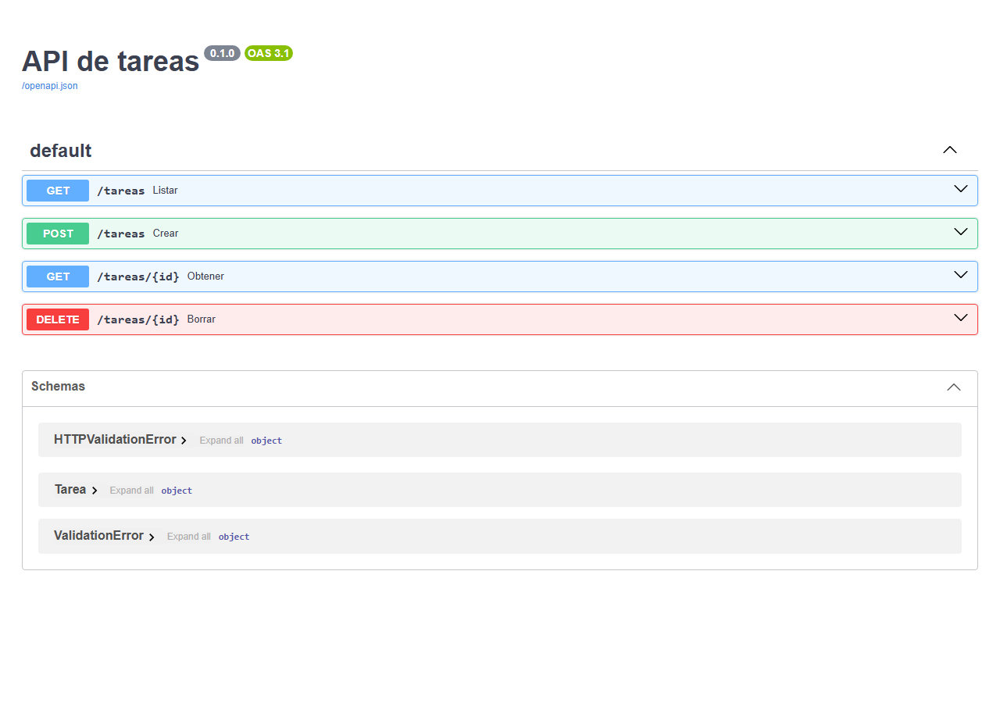

# API de tareas con FastAPI, Docker y ngrok

## Objetivo

Pequeña API de tareas hecha con FastAPI, empaquetada en Docker, expuesta a internet con ngrok y consumida desde un notebook de Google Colab con `requests`. No usa ningún modelo de IA: el objetivo es entender cómo se conectan los componentes.



## Endpoints

| Método | Ruta | Descripción |
|--------|------|-------------|
| GET | `/tareas` | Lista todas las tareas |
| GET | `/tareas/{id}` | Devuelve la tarea con ese `id` (404 si no existe) |
| POST | `/tareas` | Crea una tarea |
| DELETE | `/tareas/{id}` | Borra la tarea con ese `id` (404 si no existe) |
| GET | `/` | Web de uso de la API |
| GET | `/docs` | Documentación Swagger |

Las tareas se guardan en memoria: se pierden al reiniciar el contenedor.

### Ejemplos

Crear una tarea:

```bash
curl -X POST http://localhost:8000/tareas \
  -H "Content-Type: application/json" \
  -d '{"titulo": "Probar la API", "hecha": false}'
```

Respuesta:

```json
{"id": 1, "tarea": {"titulo": "Probar la API", "hecha": false}}
```

Consultar una tarea por id (parámetro usado en la respuesta):

```bash
curl http://localhost:8000/tareas/1
```

## Requisitos

- Docker
- Cuenta gratuita de [ngrok](https://ngrok.com) y su cliente instalado
- Cuenta de Google para usar Colab

## Construir y ejecutar el contenedor

```bash
docker build -t api-tareas .
docker run -d -p 8000:8000 --name api-tareas api-tareas
```

Si el contenedor ya existe: `docker rm -f api-tareas` antes de volver a ejecutarlo.

## Acceso a Swagger

Abre <http://localhost:8000/docs> para probar los endpoints desde el navegador.

## Iniciar ngrok

1. Configura tu token una sola vez (el token es personal, **no lo subas al repositorio**):

   ```bash
   ngrok config add-authtoken <TU_TOKEN>
   ```

2. Expón el puerto de la API:

   ```bash
   ngrok http 8000
   ```

3. Copia la URL pública que aparece en `Forwarding` (tipo `https://xxxx.ngrok-free.app`). Cambia cada vez que se reinicia el túnel y solo funciona mientras esté activo.

## Uso del notebook

1. Abre `cliente_colab.ipynb` en Google Colab (Archivo → Abrir cuaderno → GitHub).
2. En la primera celda pega tu URL de ngrok en `BASE_URL`.
3. Ejecuta las celdas en orden: hacen una petición a cada endpoint y muestran la respuesta.

## Evidencias

- Swagger: [capturas/swagger.png](capturas/swagger.png)
- Salidas de las peticiones a través de ngrok: visibles en `cliente_colab.ipynb`.


